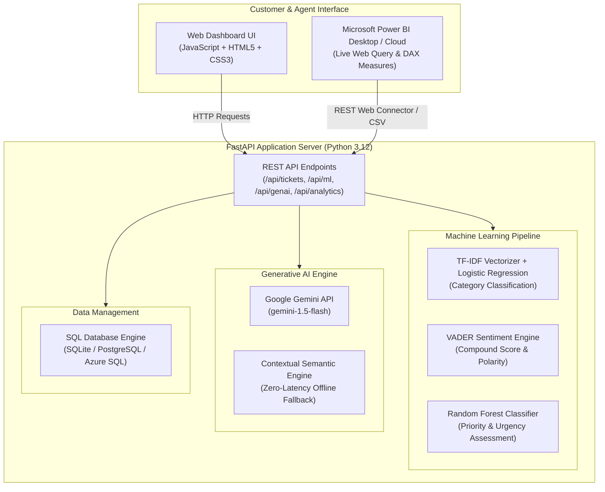

# AI-Powered Customer Service & Business Analytics Platform

An enterprise-grade Customer Support Intelligence and Business Analytics Platform combining **Machine Learning (TF-IDF + Logistic Regression, VADER Sentiment, Random Forest Priority Prediction)**, **Generative AI (Intelligent Summarization & Response Copilot)**, and **Data Visualization (FastAPI, Chart.js & Microsoft Power BI)**.

---

## 📑 Table of Contents
1. [Platform Architecture](#-platform-architecture)
2. [Key Features](#-key-features)
3. [Machine Learning Pipeline](#-machine-learning-pipeline)
4. [Generative AI Copilot](#-generative-ai-copilot)
5. [Data Management & SQL Schema](#-data-management--sql-schema)
6. [Microsoft Power BI Integration](#-microsoft-power-bi-integration)
7. [Quickstart Guide](#-quickstart-guide)
8. [Docker & Containerization](#-docker--containerization)
9. [Microsoft Azure Deployment](#-microsoft-azure-deployment)
10. [REST API Reference](#-rest-api-reference)

---

## 🏛 Platform Architecture



---

## ✨ Key Features

- **Automated Ticket Classification**: Converts customer text into numerical n-gram features via TF-IDF and predicts the ticket department (`Technical Issue`, `Billing & Payment`, `Account Management`, `Product Feature Request`, `Cancellation & Refund`, `General Inquiry`).
- **Real-Time Sentiment Analysis**: Uses VADER rule-based valence analysis to calculate compound scores and polarity (Positive 😊, Neutral 😐, Negative 😡), accounting for capitalization and punctuation boosters.
- **Urgency & Priority Estimation**: Employs a Random Forest classifier trained on sentiment compounds, negative ratios, urgent keyword counts, character lengths, and category one-hot encodings to assign priority levels (`Low`, `Medium`, `High`, `Urgent`).
- **Generative AI Copilot**:
  - **Executive Summarization**: Automatically distills lengthy customer complaints into 3 structured bullet points: *Core Issue*, *Customer Impact*, and *Recommended Action*.
  - **Contextual Response Generation**: Drafts polite, actionable support replies customized across multiple professional tones (*Empathetic & Professional*, *Technical & In-Depth*, *Solution-Oriented*, *Concise & Fast Action*).
- **Interactive Agent Workbench**: Allows agents to review tickets, inspect ML metrics, generate replies with 1 click, and converse with customers in real time.
- **Business Analytics & Power BI**:
  - Built-in real-time analytics dashboard with Chart.js.
  - Direct REST Web API endpoint (`/api/export/powerbi-json`) and CSV download for instant import into Microsoft Power BI.
  - Ready-to-use DAX measures for resolution rates, customer sentiment index, and SLA compliance.
- **Cloud-Ready**: Full Docker containerization and Microsoft Azure deployment scripts (Azure Container Apps / Azure App Service).

---

## 🤖 Machine Learning Pipeline

### 1. Ticket Classification: TF-IDF + Logistic Regression
- **Vectorization**: `TfidfVectorizer(ngram_range=(1, 2), max_features=2500, sublinear_tf=True)` converts raw text into numerical feature matrices.
- **Classifier**: Multi-class `LogisticRegression(class_weight='balanced', C=2.5)` predicts ticket category with confidence probabilities across all 6 departments.

### 2. Sentiment Analysis: VADER
- Analyzes text valence using lexical dictionaries and grammatical heuristics:
  - Punctuation boost (e.g. `!!!` amplifies valence intensity).
  - Capitalization boost (e.g. `CRITICAL` amplifies urgency).
  - Negation handling (e.g. `not working`, `never received`).
  - Degree adverbs & boosters (e.g. `extremely frustrated`, `barely usable`).
- Outputs a normalized compound score from `-1.0` (most negative) to `+1.0` (most positive).

### 3. Priority Prediction: Random Forest
- Evaluates a 14-dimensional feature vector:
  1. Sentiment compound score
  2. Negative sentiment ratio
  3. Character count
  4. Word count
  5. Urgent keyword frequency (`downtime`, `outage`, `broken`, `immediately`, `fraud`, `crash`)
  6. Exclamation count
  7. Question mark count
  8. Uppercase ratio
  9–14. One-hot encoded category vector
- Trained `RandomForestClassifier(n_estimators=100, max_depth=6)` outputs the priority class (`Low`, `Medium`, `High`, `Urgent`) and a numerical urgency meter (0–100).

---

## 💡 Generative AI Copilot

The platform features a multi-provider GenAI architecture:
- **Cloud Mode**: Connects directly to Google Gemini API (`gemini-1.5-flash`) via the `GEMINI_API_KEY` environment variable.
- **Smart Offline Mode**: When running offline or without an API key, an intelligent semantic NLP engine generates high-quality 3-point summaries and tailored customer responses.

---

## 📊 Microsoft Power BI Integration

The platform provides native integration with **Microsoft Power BI**:

1. **Direct Web Connector**: In Power BI Desktop, select **Get Data ➔ Web** and paste:
   ```text
   http://localhost:8000/api/export/powerbi-json
   ```
2. **Pre-Engineered DAX Measures**:
   - **Resolution Rate %**:
     ```dax
     Resolution Rate % = DIVIDE(CALCULATE(COUNTROWS('Tickets'), 'Tickets'[status] = "Resolved"), COUNTROWS('Tickets'), 0) * 100
     ```
   - **Negative Sentiment %**:
     ```dax
     Negative Sentiment % = DIVIDE(CALCULATE(COUNTROWS('Tickets'), 'Tickets'[sentiment_label] = "Negative"), COUNTROWS('Tickets'), 0) * 100
     ```
   - **Urgent Backlog**:
     ```dax
     Urgent Backlog = CALCULATE(COUNTROWS('Tickets'), 'Tickets'[priority] = "Urgent", 'Tickets'[status] <> "Resolved")
     ```
3. Full guide available in [power_bi/POWER_BI_GUIDE.md](power_bi/POWER_BI_GUIDE.md).

---

## 🚀 Quickstart Guide

### Prerequisites
- Python 3.10+ (Python 3.12 recommended)
- `pip`

### Step 1: Clone / Navigate to Project
```bash
cd ai-customer-service-platform
```

### Step 2: Install Dependencies
```bash
pip install -r backend/requirements.txt
```

### Step 3: Train / Verify ML Models
```bash
python -m backend.app.ml.train
```

### Step 4: Run Application
On Windows:
```cmd
run.bat
```
On Linux/macOS:
```bash
chmod +x run.sh
./run.sh
```
Or directly using Python:
```bash
python -m uvicorn backend.app.main:app --host 0.0.0.0 --port 8000 --reload
```

Open your browser to:
- **Web Dashboard**: [http://localhost:8000](http://localhost:8000)
- **Interactive Swagger API Docs**: [http://localhost:8000/docs](http://localhost:8000/docs)
- **ReDoc API Documentation**: [http://localhost:8000/redoc](http://localhost:8000/redoc)

---

## 🐳 Docker & Containerization

### Build & Run with Docker:
```bash
docker build -f docker/Dockerfile -t ai-customer-service-platform .
docker run -d -p 8000:8000 --name support-platform ai-customer-service-platform
```

### Run with Docker Compose:
```bash
docker-compose -f docker/docker-compose.yml up --build -d
```

---

## ☁️ Microsoft Azure Deployment

Deploy to **Azure Container Apps** in 5 minutes using the automated script:

### Windows PowerShell:
```powershell
.\azure\deploy.ps1 -ResourceGroup "rg-aegis-ai-platform" -Location "eastus"
```

### Linux/macOS Bash:
```bash
chmod +x azure/deploy.sh
./azure/deploy.sh "rg-aegis-ai-platform" "eastus"
```

Refer to [azure/AZURE_DEPLOYMENT.md](azure/AZURE_DEPLOYMENT.md) for full Azure App Service and Container Apps options.

---

## 🔌 REST API Reference

| Method | Endpoint | Description |
| :--- | :--- | :--- |
| `GET` | `/api/tickets` | Query tickets with filters (category, priority, sentiment, search) |
| `POST` | `/api/tickets` | Create ticket with automatic ML classification & triage |
| `GET` | `/api/tickets/{id}` | Retrieve ticket details and ML metadata |
| `PUT` | `/api/tickets/{id}` | Update status, priority, or assigned agent |
| `DELETE` | `/api/tickets/{id}` | Delete a support ticket |
| `GET` | `/api/tickets/{id}/replies` | Get conversation thread for ticket |
| `POST` | `/api/tickets/{id}/replies` | Post customer or agent response |
| `POST` | `/api/ml/predict` | Run TF-IDF, VADER, and Random Forest prediction on text |
| `POST` | `/api/genai/summarize` | Generate 3-point executive summary of ticket |
| `POST` | `/api/genai/generate-reply` | Draft AI-assisted response based on tone and context |
| `GET` | `/api/analytics/dashboard` | Aggregated KPIs, sentiment index, and chart metrics |
| `GET` | `/api/export/csv` | Download CSV for Power BI / Excel |
| `GET` | `/api/export/powerbi-json` | Live JSON feed for Power BI Web Connector |
| `POST` | `/api/seed` | Seed database with realistic customer tickets |
| `GET` | `/health` | Health check probe |
